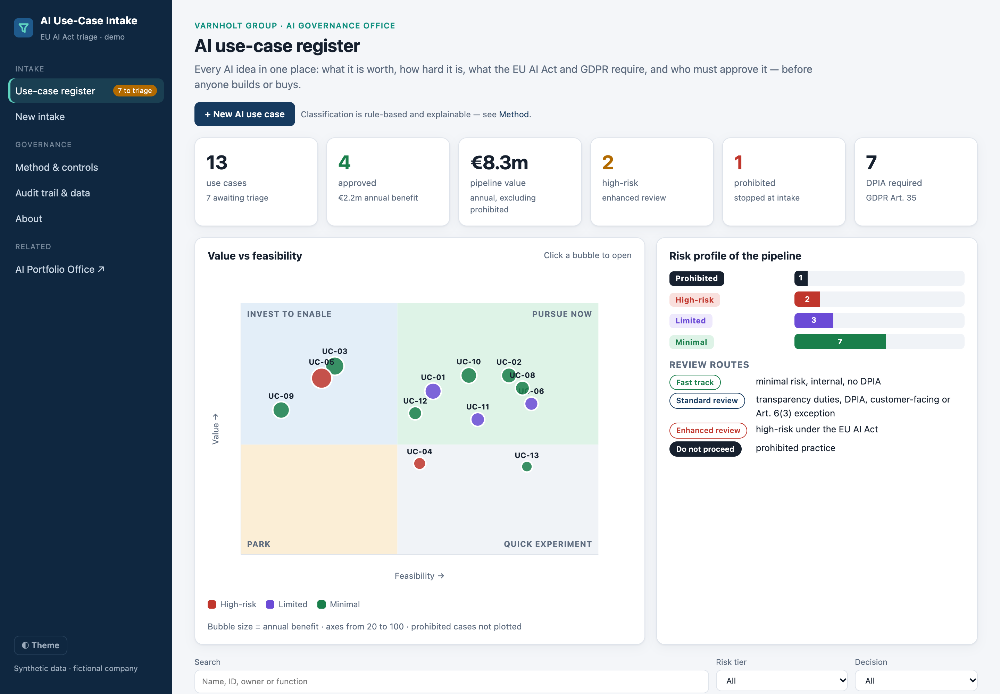
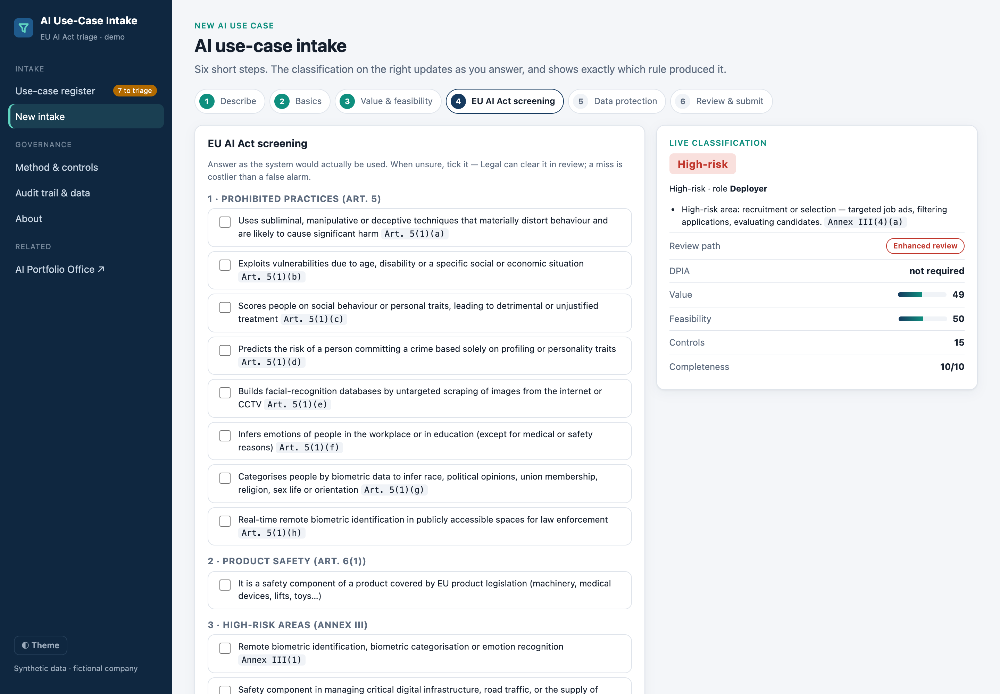
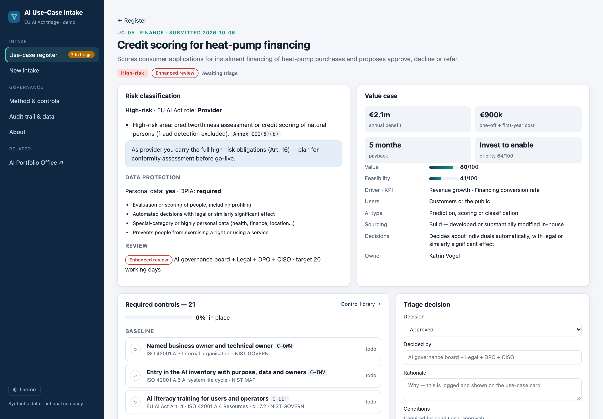
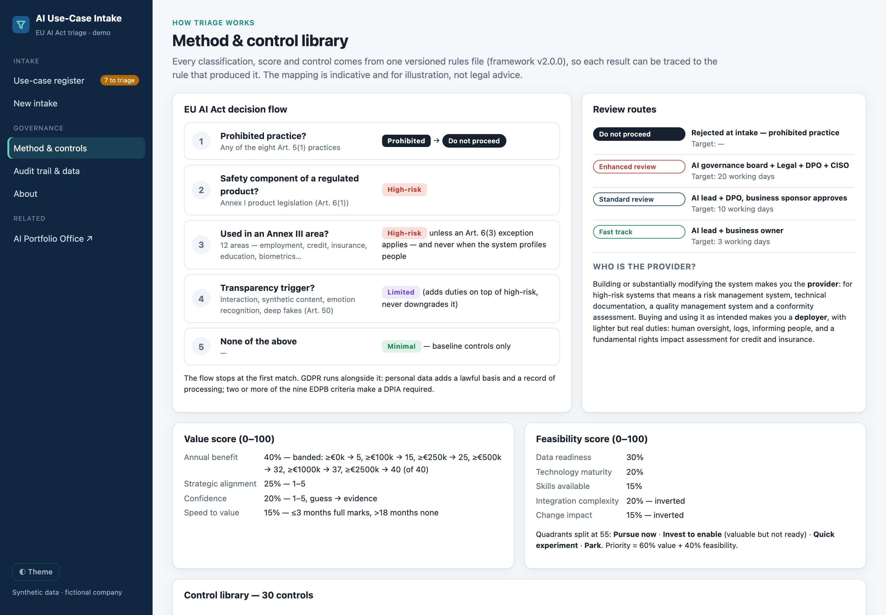
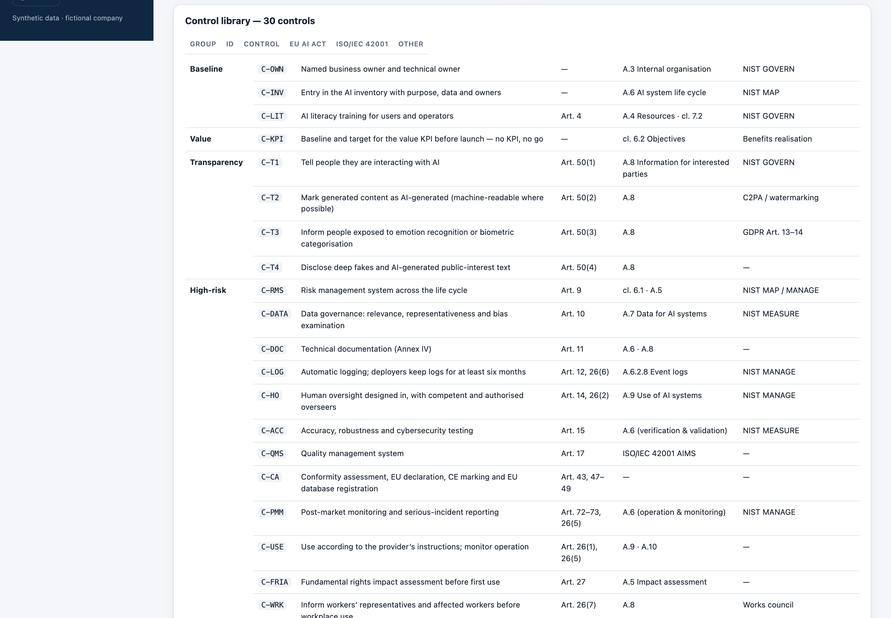

# AI Use-Case Intake

**The front door for enterprise AI: one intake that decides what is worth doing, what the EU AI Act and GDPR require, and who has to approve it, before anyone builds or buys.**

[**▶ Live demo**](https://geopap.github.io/ai-use-case-intake/) · [Method](docs/METHOD.md) · AI life cycle: **decide** → build with [Claude Code SDLC](https://github.com/geopap/claude-code-sdlc) → prove with [AI Eval Workbench](https://github.com/geopap/ai-eval-workbench) → govern with [AI Portfolio Office](https://github.com/geopap/ai-portfolio-office)



---

## Why this exists

Every company now has dozens of AI ideas: chatbots, scoring models, copilots, vision checks. Without a front door, three things go wrong at once:

- **Value is unclear.** Pilots start without a KPI or a business case, so nobody can say later whether they worked.
- **Risk is found late.** A recruitment tool or a credit model turns out to be high-risk under the EU AI Act after it has been bought or built.
- **Governance becomes a bottleneck.** Every idea gets the same heavy review, so low-risk wins wait as long as the hard cases.

This tool is that front door. It gives every idea the same short intake, an explainable risk classification, a value and feasibility score, a **review route proportionate to the risk**, the controls the use case needs, and a recorded human decision.

> **Design principle: governance should speed up good ideas, not just stop bad ones.** Minimal-risk internal tools get a three-day fast track. High-risk systems get the scrutiny the law requires. Prohibited practices are stopped at intake.

## Who it's for

| | What they get |
|---|---|
| **Product leaders** | One discovery and prioritisation step for every AI idea: a KPI, a business case, payback and a clear *pursue now / invest to enable / quick experiment / park* call before the roadmap commits |
| **Technology leaders** | Demand management with build-vs-buy, data, integration and skills readiness made explicit, and a hand-over to delivery only after approval |
| **AI governance and risk** | An explainable EU AI Act and GDPR classification with the article cited, proportionate review routes and 30 controls tracked to completion |

## What it does

| Step | What happens |
|---|---|
| **Intake** | Six short steps: what the AI does, for whom, build or buy, value and cost, feasibility, EU AI Act screening, data protection. A live panel reclassifies the use case as you answer. |
| **Classification** | Rule-based EU AI Act screening: prohibited practices (Art. 5), product safety (Art. 6(1)), the Annex III high-risk areas, the Art. 6(3) exceptions (never for profiling), transparency duties (Art. 50), and the provider vs deployer role. **Every result cites the article that produced it.** |
| **GDPR** | Personal data triggers a lawful basis and a record of processing. Two or more of the nine EDPB criteria make a DPIA required. Automated decisions trigger Art. 22 safeguards. |
| **Value & feasibility** | Benefit, cost, payback, strategic alignment, confidence and time to value, plus data, technology, skills, integration and change readiness. The result is a quadrant: *pursue now, invest to enable, quick experiment, park*. |
| **Review route** | Fast track (3 days) · Standard review (10 days) · Enhanced review for high-risk (20 days) · Do not proceed. |
| **Controls** | Up to 30 controls attached automatically, each mapped to the **EU AI Act, ISO/IEC 42001, GDPR and NIST AI RMF**, and tracked to completion. |
| **Decision** | A human approves, approves with conditions, returns or rejects, with a rationale. Unconditional approval is blocked until every required control is in place, and a prohibited practice can only be rejected. |
| **Hand-over** | Approved use cases export as initiatives into the [AI Portfolio Office](https://github.com/geopap/ai-portfolio-office), where delivery and value are tracked. |
| **Audit trail** | A SHA-256 hash-chained log of every submission, AI suggestion, control update and decision. |

### Thirteen sample cases, chosen to show the edge cases

| Case | Result | Why it is interesting |
|---|---|---|
| Credit scoring for heat-pump financing | High-risk · provider | Annex III(5)(b), automated decisions: fundamental rights impact assessment and GDPR Art. 22 |
| CV screening for installer recruitment | High-risk · deployer | Annex III(4)(a): the deployer gets lighter duties than a provider, but must inform workers |
| Applicant document completeness check | Minimal, via Art. 6(3) | In an Annex III area, but exempt because it only performs a narrow procedural task, and the exemption must be documented |
| Call-centre agent emotion monitoring | **Prohibited** | Emotion recognition in the workplace, Art. 5(1)(f): rejected, with an alternative proposed |
| AI customer service assistant | Limited risk | Art. 50 disclosure, red-teaming, and a DPIA before launch |
| Invoice data extraction | Minimal | Fast track: no personal data, mature vendor |

## AI where it helps, and where it does not

The intake can be pre-filled by Claude from a plain-language description (optional, with your own API key). The guardrails are the point:

- **Suggestions only.** Every AI-filled answer is marked and must be confirmed by the submitter. Submission is blocked until all are confirmed.
- **The rules decide.** The risk tier is always computed by the deterministic engine, never by the model.
- **No money from the model.** Benefits, costs and feasibility are human inputs, because they are what people are held accountable for.
- **Data minimisation.** Emails, phone numbers and IBANs are redacted before sending, and the owner's name is never sent.
- **Structured output, re-validated.** The model must answer in a strict JSON schema, and every value is checked again against the allowed options before it touches the form.
- **Prompt-injection aware.** The idea text is treated as untrusted data.

## Try it

1. Open the [live demo](https://geopap.github.io/ai-use-case-intake/) and browse the register.
2. Open **UC-05 Credit scoring**, then **UC-13** and **UC-07**: high-risk, exempt and prohibited, each with the reasoning shown.
3. Click **+ New AI use case** and describe your own idea. Watch the live classification change as you answer.
4. Record a triage decision. An unconditional approval is refused while controls are open, so approve with conditions instead.
5. Export the use-case card as Markdown, or send an approved case to the AI Portfolio Office.

Run it locally (no build step, no dependencies):

```bash
git clone https://github.com/geopap/ai-use-case-intake.git
cd ai-use-case-intake
python3 -m http.server 8080      # then open http://localhost:8080
npm test                         # 20 tests: classification rules, controls, AI guardrails, exports (Node 20+)
```

## Screenshots

| Intake with live classification | Use-case assessment and controls |
|---|---|
|  |  |
| **EU AI Act decision flow** | **Control library** |
|  |  |

## How it is built

Plain HTML, CSS and JavaScript modules, with no framework, no build step, no backend and no third-party scripts, so every rule can be read in this repository.

```
js/framework.js   the screening framework as code: Art. 5, Annex III, Art. 6(3), Art. 50, EDPB criteria, scoring weights
js/controls.js    30 controls, each with the condition under which it applies and its references
js/triage.js      deterministic engine: classification, DPIA, scores, quadrant, review route, controls
js/llm.js         optional Claude pre-fill: redaction, strict JSON schema, local re-validation
js/export.js      Markdown use-case card and conversion into AI Portfolio Office initiatives
js/audit.js       SHA-256 hash-chained audit trail
tests/*           node:test suites
```

Security baseline: a strict Content-Security-Policy, escaping of all output, no third-party code, and an API key held for the browser tab only. See [SECURITY.md](SECURITY.md).

## About

Built by **George Papadongonas**, a digital leader focused on **AI value creation**: turning AI from pilots into measurable P&L impact, with the governance, compliance and security that let it scale.

*All data in this repository is synthetic. **Varnholt Group** is a fictional company. The regulatory mapping is indicative and is not legal advice. Check current application dates for the high-risk obligations, which have been subject to legislative change.*

## License

[MIT](LICENSE)
